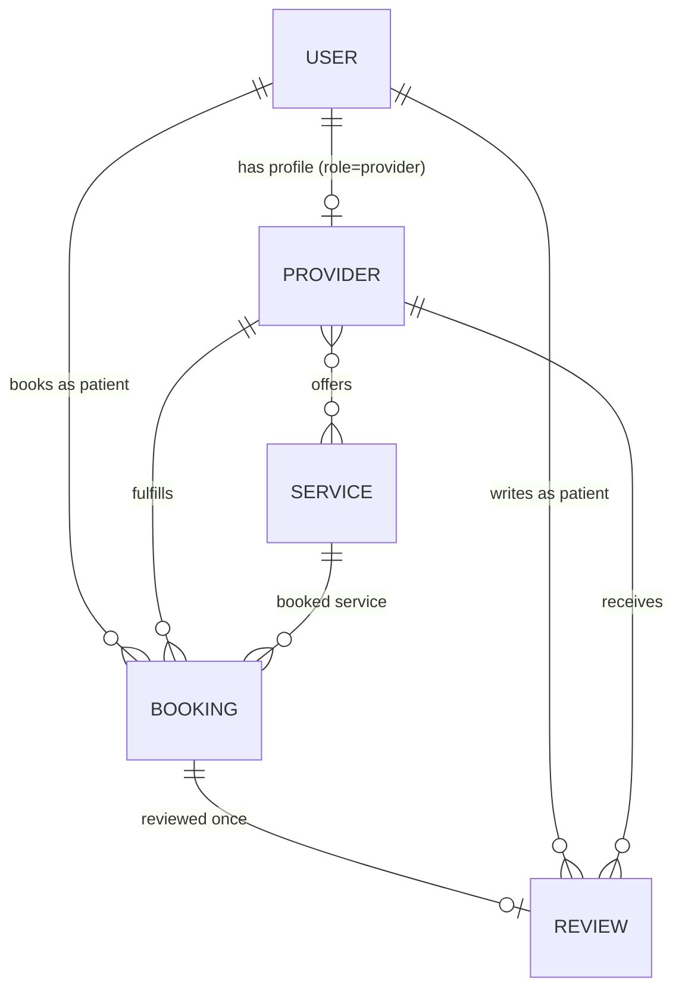

# Afya Homecare: Architecture Document

> **Status:** Draft v1.0 (pre-implementation)
> **Scope:** System requirements, database design, and repository structure for the MVP and near-term roadmap.

Afya Homecare is a two-sided marketplace that connects **patients** who need care at home with **verified healthcare providers** (nurses, caregivers, physiotherapists, etc.). Patients discover and book services, providers manage their availability and visits, and admins vet providers and oversee the platform.

## Table of Contents

1. [System Requirements & Core Features](#1-system-requirements--core-features)
2. [Database Schema (MongoDB / Mongoose)](#2-database-schema-mongodb--mongoose)
3. [Project Folder Structure](#3-project-folder-structure)
4. [Cross-Cutting Conventions](#4-cross-cutting-conventions)
5. [Suggested Build Order](#5-suggested-build-order)

## Tech Stack

| Layer      | Technology                                         |
| ---------- | -------------------------------------------------- |
| Frontend   | React, TypeScript, Tailwind CSS (Vite recommended) |
| Backend    | Node.js, Express.js (TypeScript recommended)       |
| Database   | MongoDB with Mongoose ODM                          |
| Auth       | JWT access token + refresh token (httpOnly cookie) |
| Validation | Zod (shared between client and server)             |
| Tooling    | npm workspaces, ESLint, Prettier, Vitest/Jest      |

---

# 1. System Requirements & Core Features

## 1.1 User Roles

| Role                                 | Description                                                  | Key Capabilities                                                                                       |
| ------------------------------------ | ------------------------------------------------------------ | ------------------------------------------------------------------------------------------------------ |
| **Patient / Client** (`patient`)     | A person (or family member) booking care for themselves or a dependent. | Search providers and services, book visits, pay, cancel, review providers, manage profile and addresses. |
| **Healthcare Provider** (`provider`) | A nurse, caregiver, physiotherapist, or other professional offering home visits. | Create a professional profile, submit credentials for verification, set services and availability, accept or reject bookings, complete visits, respond to reviews. |
| **Admin** (`admin`)                  | Platform operator.                                           | Verify or reject providers, manage service catalog, view and moderate all bookings and reviews, suspend users, view platform analytics. |

> **Design note:** A user has exactly one role. A provider is a `User` (role `provider`) with an attached `Provider` profile document. Anyone who wants both roles uses two accounts in the MVP.

## 1.2 Functional Requirements

### Authentication & Account Management
- **FR-1.1** Register with email (or phone) and password; choose role `patient` or `provider` at sign-up. Admin accounts are created only through a seed script or by another admin.
- **FR-1.2** Log in and log out; sessions use short-lived access tokens and rotating refresh tokens.
- **FR-1.3** Email verification and password reset via emailed one-time link.
- **FR-1.4** Role-based access control (RBAC) enforced on every protected API route.
- **FR-1.5** Users can edit their profile, change password, and deactivate their account.

### Patient Features
- **FR-2.1** Browse the service catalog by category (e.g., wound care, elderly care, physiotherapy, injections, post-surgery care).
- **FR-2.2** Search and filter verified providers by service, location or distance, rating, price, language, gender, and availability date.
- **FR-2.3** View a provider's public profile: bio, qualifications, services and prices, ratings, and reviews.
- **FR-2.4** Create a booking: pick service, provider, date and time slot, service address, and notes (e.g., conditions, special needs).
- **FR-2.5** View upcoming and past bookings; cancel according to the cancellation policy.
- **FR-2.6** Pay for a booking through a pluggable payment gateway (provider-agnostic abstraction; mobile money and card support to be decided).
- **FR-2.7** Leave one rating and review per completed booking.
- **FR-2.8** Receive notifications (email now, SMS or push later) on every booking status change.

### Provider Features
- **FR-3.1** Complete a professional profile: profession, license number, years of experience, qualifications, languages, bio, photo.
- **FR-3.2** Upload credential documents; profile stays `pending` until an admin approves it.
- **FR-3.3** Select offered services from the catalog, with optional custom price and duration.
- **FR-3.4** Define weekly availability, time-off dates, and a service area (center point and radius).
- **FR-3.5** View incoming booking requests; accept or reject within a response window.
- **FR-3.6** Update visit status (`in_progress`, `completed`) and add visit notes.
- **FR-3.7** View earnings summary and booking history.
- **FR-3.8** Respond publicly to reviews.

### Admin Features
- **FR-4.1** Review the provider verification queue; approve, reject (with reason), or request more documents.
- **FR-4.2** CRUD for the service catalog and categories.
- **FR-4.3** View, search, and manage all users, bookings, and reviews; suspend or reactivate accounts.
- **FR-4.4** Moderate reviews (hide abusive or fraudulent content).
- **FR-4.5** Dashboard metrics: active users, bookings per day, revenue, provider approval backlog, cancellation rate.
- **FR-4.6** Audit trail of sensitive admin actions.

## 1.3 Non-Functional Requirements

| Area                  | Requirement                                                                                         |
| --------------------- | --------------------------------------------------------------------------------------------------- |
| **Security**          | Passwords hashed with bcrypt or argon2; JWT secrets in environment variables; rate limiting on auth routes; Helmet, CORS allowlist, input validation and sanitization on all routes (NoSQL injection protection). |
| **Privacy / Health data** | Collect the minimum health information needed. Free-text medical notes are sensitive: encrypt at rest (field-level or disk-level), restrict access to the booking's patient, assigned provider, and admins, and never log them. Review applicable local health-data and privacy regulations before launch. |
| **Performance**       | List endpoints are paginated (cursor or page-based); common queries are covered by indexes (see Section 2); p95 API latency under 500 ms for reads. |
| **Scalability**       | Stateless API servers (horizontal scaling); file uploads go to object storage, never local disk in production. |
| **Reliability**       | Booking creation is atomic with respect to double-booking (see the unique partial index in Section 2). |
| **Accessibility & i18n** | WCAG-aware UI, mobile-first layouts, and string externalization from day one so additional languages (e.g., Amharic) can be added. |
| **Observability**     | Structured logging, request IDs, central error handling, health-check endpoint.                     |
| **Testability**       | Unit tests for services and utilities; integration tests for API routes against an in-memory MongoDB. |

## 1.4 Core User Flows

### Flow A: Patient Books a Service
1. Patient signs up or logs in, then verifies email.
2. Patient browses services or searches providers by service, location, and date.
3. Patient opens a provider profile and clicks **Book**.
4. Patient picks a service, date and time slot (from provider availability minus existing bookings), enters the service address and notes.
5. System creates a `Booking` with status `pending` and snapshots the price and service details.
6. Provider is notified and **accepts** (`confirmed`) or **rejects** (`rejected`) before the response deadline; otherwise the booking auto-expires (`cancelled`, by system).
7. On confirmation, the patient pays (payment status `paid`) and receives a confirmation notification.
8. At visit time, the provider marks `in_progress`, then `completed`.
9. Patient is prompted to leave a rating and review.

### Flow B: Provider Onboarding & Verification
1. User registers as `provider`, completes the profile, and uploads license and ID documents.
2. Provider profile status is `pending`; the provider is **not** publicly listed.
3. Admin reviews the queue and sets `approved` or `rejected` (with reason).
4. On approval, the provider can set services and availability and is listed in search.
5. The provider can start receiving booking requests.

### Flow C: Booking Lifecycle (State Machine)

```
            ┌──────────────┐  provider rejects   ┌──────────┐
 create ──► │   pending    │ ──────────────────► │ rejected │
            └──────┬───────┘                     └──────────┘
                   │ provider accepts
                   ▼
            ┌──────────────┐  cancel (patient/provider/admin)  ┌───────────┐
            │  confirmed   │ ────────────────────────────────► │ cancelled │
            └──────┬───────┘                                   └───────────┘
                   │ visit starts            (also reachable from pending)
                   ▼
            ┌──────────────┐  provider/patient absent  ┌─────────┐
            │ in_progress  │ ────────────────────────► │ no_show │
            └──────┬───────┘                           └─────────┘
                   │ visit ends
                   ▼
            ┌──────────────┐
            │  completed   │ ──► review allowed
            └──────────────┘
```

Allowed transitions are enforced in a single server-side service function, never in controllers or the client.

### Flow D: Admin Moderation
1. Admin opens the dashboard and sees the pending-verification count and flagged reviews.
2. Admin processes the queue (approve, reject, or request documents).
3. Admin can suspend a user; suspended users cannot log in and their open bookings are flagged for manual handling.

---

# 2. Database Schema (MongoDB / Mongoose Design)

## 2.1 Entity Relationship Overview



## 2.2 Design Principles

- **Reference vs. embed:** Reference documents that are queried independently or grow without bound (bookings, reviews). Embed small, bounded data that is always read together (addresses, availability, status history).
- **Snapshots:** A booking stores a **snapshot** of price, service name, duration, and address at booking time, so later catalog or profile edits never rewrite history.
- **Denormalized counters:** Provider `ratingAverage` and `ratingCount` are updated whenever a review is created or hidden, so search results do not need aggregation.
- **Money:** Store amounts as **integers in the smallest currency unit** (e.g., cents or santim) alongside a `currency` code, to avoid floating-point errors.
- **Timestamps:** All schemas use `{ timestamps: true }` (`createdAt`, `updatedAt`). Store all dates in UTC.
- **Geo data:** Locations use GeoJSON `Point` (`[longitude, latitude]`) with `2dsphere` indexes.
- **Soft deletion:** Users and bookings are deactivated or status-changed, not hard-deleted, to preserve audit history.

## 2.3 `users` Collection

Authentication identity and common profile data for all roles.

| Field                | Type                 | Required | Notes                                                           |
| -------------------- | -------------------- | :------: | --------------------------------------------------------------- |
| `_id`                | ObjectId             | auto     |                                                                 |
| `email`              | String               | yes      | Lowercased, trimmed, unique.                                    |
| `phone`              | String               | no       | E.164 format; unique when present (sparse).                     |
| `passwordHash`       | String               | yes      | `select: false`. Never returned by default.                     |
| `role`               | String enum          | yes      | `patient`, `provider`, `admin`.                                 |
| `firstName`          | String               | yes      |                                                                 |
| `lastName`           | String               | yes      |                                                                 |
| `gender`             | String enum          | no       | `male`, `female`, `other`, `undisclosed`.                       |
| `dateOfBirth`        | Date                 | no       |                                                                 |
| `avatarUrl`          | String               | no       | Object-storage URL.                                             |
| `addresses`          | `[Address]` embedded | no       | Saved addresses (patients). Max ~10.                            |
| `emergencyContact`   | Object               | no       | `{ name, phone, relationship }`.                                |
| `status`             | String enum          | yes      | `active` (default), `suspended`, `deactivated`.                 |
| `isEmailVerified`    | Boolean              | yes      | Default `false`.                                                |
| `isPhoneVerified`    | Boolean              | yes      | Default `false`.                                                |
| `emailVerification`  | Object               | no       | `{ tokenHash, expiresAt }`. `select: false`.                    |
| `passwordReset`      | Object               | no       | `{ tokenHash, expiresAt }`. `select: false`.                    |
| `refreshTokens`      | `[Object]`           | no       | `{ tokenHash, userAgent, expiresAt }`; supports rotation and revocation. `select: false`. |
| `lastLoginAt`        | Date                 | no       |                                                                 |
| `createdAt`/`updatedAt` | Date              | auto     |                                                                 |

**Embedded `Address` subdocument**

| Field        | Type    | Notes                                          |
| ------------ | ------- | ---------------------------------------------- |
| `label`      | String  | e.g., "Home", "Parents' house".                |
| `line1`      | String  | Street / landmark description.                 |
| `line2`      | String  | Optional.                                      |
| `city`       | String  |                                                |
| `region`     | String  | State / region.                                |
| `country`    | String  | ISO 3166-1 alpha-2.                            |
| `location`   | GeoJSON Point | `{ type: "Point", coordinates: [lng, lat] }` |
| `isDefault`  | Boolean |                                                |

**Indexes**

| Index                       | Options              | Purpose                                      |
| --------------------------- | -------------------- | -------------------------------------------- |
| `{ email: 1 }`              | `unique`             | Login and uniqueness.                        |
| `{ phone: 1 }`              | `unique`, `sparse`   | Phone login / uniqueness when provided.      |
| `{ role: 1, status: 1 }`    |                      | Admin user listing and filtering.            |
| `{ "refreshTokens.tokenHash": 1 }` | `sparse`      | Refresh-token lookup.                        |

## 2.4 `providers` Collection

Professional profile for users with role `provider` (one-to-one with `users`).

| Field                    | Type                  | Required | Notes                                                         |
| ------------------------ | --------------------- | :------: | ------------------------------------------------------------- |
| `_id`                    | ObjectId              | auto     |                                                               |
| `user`                   | ObjectId → `User`     | yes      | Unique. The account that owns this profile.                   |
| `profession`             | String enum           | yes      | `nurse`, `caregiver`, `physiotherapist`, `doctor`, `midwife`, `lab_technician`, `other`. |
| `headline`               | String                | no       | Short tagline (max ~120 chars).                               |
| `bio`                    | String                | no       | Max ~1500 chars.                                              |
| `yearsOfExperience`      | Number                | no       | Min 0.                                                        |
| `specialties`            | [String]              | no       | e.g., "wound care", "geriatrics".                             |
| `languages`              | [String]              | no       | ISO 639-1 codes.                                              |
| `qualifications`         | [Object]              | no       | `{ title, institution, year }`.                               |
| `license`                | Object                | yes      | `{ number, issuingBody, expiresAt, documentUrl }`.            |
| `identityDocumentUrl`    | String                | no       | Private storage reference (signed URLs only).                 |
| `verification`           | Object                | yes      | `{ status, reviewedBy (→ User), reviewedAt, rejectionReason }`. `status` enum: `pending` (default), `approved`, `rejected`, `needs_info`. |
| `services`               | [Object]              | no       | `{ service (→ Service), customPrice: { amount, currency }, customDurationMinutes, isActive }`. Must be validated against the service catalog. |
| `serviceArea`            | Object                | yes      | `{ location: GeoJSON Point, radiusKm: Number, city, region }`. |
| `availability`           | Object                | no       | `{ timezone, weekly: [{ dayOfWeek (0-6), slots: [{ start: "HH:mm", end: "HH:mm" }] }] }`. |
| `timeOff`                | [Object]              | no       | `{ from: Date, to: Date, reason }`.                           |
| `isAcceptingBookings`    | Boolean               | yes      | Default `true`. Provider-controlled pause switch.             |
| `ratingAverage`          | Number                | yes      | Default `0`. Denormalized.                                    |
| `ratingCount`            | Number                | yes      | Default `0`. Denormalized.                                    |
| `completedBookingsCount` | Number                | yes      | Default `0`. Denormalized.                                    |
| `createdAt`/`updatedAt`  | Date                  | auto     |                                                               |

**Indexes**

| Index                                                         | Options   | Purpose                                              |
| ------------------------------------------------------------- | --------- | ---------------------------------------------------- |
| `{ user: 1 }`                                                 | `unique`  | One profile per user; lookup by user.                |
| `{ "serviceArea.location": "2dsphere" }`                      |           | "Providers near me" geo queries.                     |
| `{ "verification.status": 1, createdAt: 1 }`                  |           | Admin verification queue (oldest first).             |
| `{ "services.service": 1, "verification.status": 1, ratingAverage: -1 }` | | Search by service among approved providers, sorted by rating. |
| `{ profession: 1, isAcceptingBookings: 1, ratingAverage: -1 }` |          | Browse by profession.                                |
| `{ headline: "text", bio: "text", specialties: "text" }`      | text      | Keyword search.                                      |

> **Public visibility rule:** A provider appears in public search only when `verification.status === "approved"`, `isAcceptingBookings === true`, and the linked user `status === "active"`.

## 2.5 `services` Collection

The platform-managed catalog of care services.

| Field                    | Type                | Required | Notes                                                       |
| ------------------------ | ------------------- | :------: | ----------------------------------------------------------- |
| `_id`                    | ObjectId            | auto     |                                                             |
| `name`                   | String              | yes      | e.g., "Post-surgical wound dressing".                       |
| `slug`                   | String              | yes      | Unique, URL-safe.                                           |
| `category`               | String enum         | yes      | `nursing`, `elderly_care`, `physiotherapy`, `maternal_newborn`, `chronic_care`, `lab_sampling`, `palliative`, `other`. |
| `description`            | String              | yes      |                                                             |
| `imageUrl`               | String              | no       |                                                             |
| `pricingModel`           | String enum         | yes      | `fixed` or `hourly`.                                        |
| `basePrice`              | Object              | yes      | `{ amount: Number (minor units), currency: String }`.       |
| `defaultDurationMinutes` | Number              | yes      | Min 15.                                                     |
| `allowedProfessions`     | [String enum]       | no       | Professions permitted to offer this service; empty means any. |
| `requiresPrescription`   | Boolean             | no       | Default `false`.                                            |
| `isActive`               | Boolean             | yes      | Default `true`. Inactive services are hidden, not deleted.  |
| `createdAt`/`updatedAt`  | Date                | auto     |                                                             |

**Indexes**

| Index                                      | Options  | Purpose                      |
| ------------------------------------------ | -------- | ---------------------------- |
| `{ slug: 1 }`                              | `unique` | Public URLs.                 |
| `{ category: 1, isActive: 1 }`             |          | Catalog browsing by category.|
| `{ name: "text", description: "text" }`    | text     | Service search.              |

## 2.6 `bookings` Collection

The central transactional record. References live entities and **snapshots** values that must not change retroactively.

| Field                  | Type                     | Required | Notes                                                        |
| ---------------------- | ------------------------ | :------: | ------------------------------------------------------------ |
| `_id`                  | ObjectId                 | auto     |                                                              |
| `bookingNumber`        | String                   | yes      | Human-friendly unique code, e.g., `AFY-2026-000123`.         |
| `patient`              | ObjectId → `User`        | yes      |                                                              |
| `provider`             | ObjectId → `Provider`    | yes      |                                                              |
| `service`              | ObjectId → `Service`     | yes      |                                                              |
| `serviceSnapshot`      | Object                   | yes      | `{ name, category, durationMinutes }` at booking time.       |
| `scheduledStart`       | Date                     | yes      | UTC.                                                         |
| `scheduledEnd`         | Date                     | yes      | UTC. Computed from duration.                                 |
| `address`              | Address (embedded)       | yes      | Snapshot of the visit location, including GeoJSON point.     |
| `patientNotes`         | String                   | no       | **Sensitive.** Reason for visit, conditions, access instructions. |
| `recipientInfo`        | Object                   | no       | If booking for a dependent: `{ name, age, relationship }`.   |
| `status`               | String enum              | yes      | `pending` (default), `confirmed`, `in_progress`, `completed`, `cancelled`, `rejected`, `no_show`. |
| `statusHistory`        | [Object]                 | yes      | `{ status, changedBy (→ User), at, reason }`. Append-only.   |
| `responseDeadline`     | Date                     | no       | Provider must respond before this; used by an expiry job.    |
| `pricing`              | Object                   | yes      | `{ currency, subtotal, platformFee, total }` in minor units. |
| `payment`              | Object                   | yes      | `{ status (unpaid / paid / refunded / failed), method, transactionRef, paidAt, refundedAt }`. |
| `cancellation`         | Object                   | no       | `{ cancelledBy (→ User), role, reason, at }`.                |
| `visitNotes`           | String                   | no       | **Sensitive.** Written by provider after the visit.          |
| `startedAt`/`completedAt` | Date                  | no       | Actual visit timing.                                         |
| `review`               | ObjectId → `Review`      | no       | Set after a review is created (convenience pointer).         |
| `createdAt`/`updatedAt`| Date                     | auto     |                                                              |

**Indexes**

| Index                                                               | Options                          | Purpose                                              |
| ------------------------------------------------------------------- | -------------------------------- | ---------------------------------------------------- |
| `{ bookingNumber: 1 }`                                              | `unique`                         | Lookup by code.                                      |
| `{ patient: 1, scheduledStart: -1 }`                                |                                  | Patient's booking list.                              |
| `{ provider: 1, status: 1, scheduledStart: 1 }`                     |                                  | Provider's schedule and request inbox.               |
| `{ status: 1, scheduledStart: 1 }`                                  |                                  | Admin views and background jobs.                     |
| `{ status: 1, responseDeadline: 1 }`                                | partial: `status = "pending"`    | Auto-expire unanswered requests.                     |
| `{ provider: 1, scheduledStart: 1 }`                                | **unique, partial**: `status` in `["pending","confirmed","in_progress"]` | **Prevents double-booking** the same provider at the same start time. |

> **Double-booking note:** The partial unique index blocks identical start times only. Overlapping ranges with different start times must be checked in the booking service inside a MongoDB **transaction** (or an equivalent optimistic-locking approach) before insert. Slots can be generated on a fixed grid (e.g., 30 minutes) to keep this simple in the MVP.

## 2.7 `reviews` Collection

One review per completed booking, written by the patient.

| Field              | Type                  | Required | Notes                                                        |
| ------------------ | --------------------- | :------: | ------------------------------------------------------------ |
| `_id`              | ObjectId              | auto     |                                                              |
| `booking`          | ObjectId → `Booking`  | yes      | Unique. Guarantees one review per booking.                   |
| `patient`          | ObjectId → `User`     | yes      | Must equal `booking.patient`.                                |
| `provider`         | ObjectId → `Provider` | yes      | Must equal `booking.provider`.                               |
| `service`          | ObjectId → `Service`  | yes      | Enables per-service rating analytics.                        |
| `rating`           | Number                | yes      | Integer 1 to 5.                                              |
| `comment`          | String                | no       | Max ~1000 chars.                                             |
| `providerResponse` | Object                | no       | `{ text, respondedAt }`.                                     |
| `moderation`       | Object                | yes      | `{ status (visible default / hidden), reason, moderatedBy (→ User), moderatedAt }`. |
| `createdAt`/`updatedAt` | Date             | auto     |                                                              |

**Indexes**

| Index                                         | Options  | Purpose                                         |
| --------------------------------------------- | -------- | ----------------------------------------------- |
| `{ booking: 1 }`                              | `unique` | One review per booking.                         |
| `{ provider: 1, "moderation.status": 1, createdAt: -1 }` |  | Provider profile review list.             |
| `{ patient: 1, createdAt: -1 }`               |          | "My reviews".                                   |
| `{ "moderation.status": 1, createdAt: -1 }`   |          | Admin moderation queue.                         |

**Business rules**
- A review can be created only if `booking.status === "completed"` and the requester is `booking.patient`.
- On create, hide, or unhide, recalculate the provider's `ratingAverage` and `ratingCount` (incremental update or aggregate).

## 2.8 Supporting Collections (Post-MVP, Recommended)

| Collection       | Purpose                                                                                      |
| ---------------- | -------------------------------------------------------------------------------------------- |
| `notifications`  | In-app notifications: `user`, `type`, `payload`, `readAt`. Index `{ user: 1, readAt: 1, createdAt: -1 }`. |
| `auditLogs`      | Admin and security-sensitive actions: `actor`, `action`, `target`, `metadata`, `ip`. Index `{ actor: 1, createdAt: -1 }`. |
| `payments`       | Split out of `bookings` when multiple payment attempts, refunds, and provider payouts need full tracking. |
| `conversations` / `messages` | Patient-provider messaging tied to a booking.                              |

---

# 3. Project Folder Structure

A **monorepo** using npm workspaces: one repository, two deployable apps, and an optional shared package for types and validation schemas.

## 3.1 High-Level Layout

```
afya-homecare/
├── client/                     # React + TypeScript + Tailwind frontend (Vite)
├── server/                     # Node + Express + MongoDB backend
├── shared/                     # (Optional) shared TS types and Zod schemas
├── docs/                       # Extra docs: API spec, ADRs, diagrams
├── .github/
│   └── workflows/              # CI pipelines (lint, test, build)
├── .editorconfig
├── .gitignore
├── .prettierrc
├── package.json                # Root: workspaces + convenience scripts
├── ARCHITECTURE.md             # This document
└── README.md                   # Setup and run instructions
```

## 3.2 `/server` (Node + Express + MongoDB)

```
server/
├── src/
│   ├── config/
│   │   ├── env.ts                  # Loads and validates environment variables
│   │   ├── db.ts                   # Mongoose connection setup
│   │   └── constants.ts            # Roles, statuses, enums
│   ├── models/
│   │   ├── user.model.ts
│   │   ├── provider.model.ts
│   │   ├── service.model.ts
│   │   ├── booking.model.ts
│   │   ├── review.model.ts
│   │   └── index.ts
│   ├── modules/                    # Feature modules (route + controller + service + validation)
│   │   ├── auth/
│   │   │   ├── auth.routes.ts
│   │   │   ├── auth.controller.ts
│   │   │   ├── auth.service.ts
│   │   │   └── auth.validation.ts
│   │   ├── users/
│   │   ├── providers/
│   │   ├── services/
│   │   ├── bookings/
│   │   ├── reviews/
│   │   └── admin/
│   ├── middleware/
│   │   ├── authenticate.ts         # Verifies JWT, attaches req.user
│   │   ├── authorize.ts            # Role-based access control
│   │   ├── validate.ts             # Zod request validation
│   │   ├── errorHandler.ts         # Central error handling
│   │   ├── rateLimiter.ts
│   │   └── upload.ts               # Multer / file upload handling
│   ├── services/                   # Cross-module integrations
│   │   ├── email.service.ts
│   │   ├── storage.service.ts      # S3-compatible object storage wrapper
│   │   ├── payment/                # Payment gateway interface + adapters
│   │   └── notification.service.ts
│   ├── jobs/                       # Scheduled/background work
│   │   ├── expirePendingBookings.job.ts
│   │   └── index.ts
│   ├── utils/
│   │   ├── ApiError.ts
│   │   ├── asyncHandler.ts
│   │   ├── logger.ts
│   │   ├── pagination.ts
│   │   └── tokens.ts               # JWT sign/verify, token hashing
│   ├── types/                      # Express augmentations, shared server types
│   ├── routes.ts                   # Mounts all module routers under /api/v1
│   ├── app.ts                      # Express app setup (middleware, routes)
│   └── server.ts                   # Entry point: connect DB, start listening
├── scripts/
│   ├── seed.ts                     # Seeds admin user and service catalog
│   └── syncIndexes.ts              # Ensures Mongoose indexes exist
├── tests/
│   ├── unit/
│   ├── integration/
│   └── setup.ts                    # In-memory MongoDB test setup
├── .env.example
├── package.json
└── tsconfig.json
```

| Folder / File          | Responsibility                                                                                   |
| ---------------------- | ------------------------------------------------------------------------------------------------ |
| `config/`              | Environment validation, DB connection, constants. The only place that reads `process.env`.       |
| `models/`              | Mongoose schemas and models, indexes, virtuals, and model-level hooks. No business logic.        |
| `modules/<feature>/`   | Vertical slice per feature. **Routes** declare endpoints; **controllers** handle HTTP in and out; **services** hold business logic; **validation** holds Zod schemas. |
| `middleware/`          | Reusable Express middleware (auth, RBAC, validation, errors, rate limiting, uploads).            |
| `services/`            | Integrations with external systems (email, storage, payments, notifications) behind interfaces.  |
| `jobs/`                | Cron/queue tasks such as expiring unanswered bookings and sending reminders.                     |
| `utils/`               | Small, pure helpers with no framework coupling.                                                  |
| `app.ts` vs `server.ts`| `app.ts` builds the Express app (importable in tests); `server.ts` starts the network listener. |
| `scripts/`             | One-off operational scripts (seeding, index sync, migrations).                                   |
| `tests/`               | Unit tests for services and utils; integration tests that call the API against a test database.  |

**Request flow:** `route → validate → authenticate → authorize → controller → service → model → response`, with errors flowing to `errorHandler`.

## 3.3 `/client` (React + TypeScript + Tailwind)

```
client/
├── public/                         # Static assets served as-is
├── src/
│   ├── assets/                     # Images, icons, fonts
│   ├── components/
│   │   ├── ui/                     # Generic primitives: Button, Input, Modal, Badge, Spinner
│   │   ├── layout/                 # Navbar, Footer, Sidebar, PageContainer
│   │   └── shared/                 # Domain-aware shared pieces: RatingStars, StatusBadge, ProviderCard
│   ├── features/                   # Feature-first organization (mirrors server modules)
│   │   ├── auth/
│   │   │   ├── components/         # LoginForm, RegisterForm
│   │   │   ├── hooks/
│   │   │   ├── api.ts              # API calls for this feature
│   │   │   └── types.ts
│   │   ├── providers/              # Search, filters, provider profile, provider onboarding
│   │   ├── services/               # Catalog browsing
│   │   ├── bookings/               # Booking wizard, booking list/detail
│   │   ├── reviews/
│   │   └── admin/                  # Verification queue, user management, moderation, dashboard
│   ├── pages/                      # Route-level components
│   │   ├── public/                 # Home, Services, ProviderProfile, NotFound
│   │   ├── auth/                   # Login, Register, ForgotPassword
│   │   ├── patient/                # Dashboard, MyBookings, Profile
│   │   ├── provider/               # Dashboard, Requests, Schedule, Earnings, Profile
│   │   └── admin/                  # Dashboard, Providers, Users, Bookings, Reviews
│   ├── routes/
│   │   ├── AppRouter.tsx           # Route definitions (lazy-loaded)
│   │   ├── ProtectedRoute.tsx      # Auth + role guard
│   │   └── paths.ts                # Centralized route constants
│   ├── lib/
│   │   ├── apiClient.ts            # Axios/fetch wrapper: base URL, token refresh, error normalization
│   │   ├── queryClient.ts          # TanStack Query configuration
│   │   └── utils.ts                # Formatting (dates, money), helpers
│   ├── context/                    # Global providers (AuthContext, ThemeContext)
│   ├── hooks/                      # Reusable hooks (useAuth, useDebounce, useGeolocation)
│   ├── types/                      # Global TypeScript types and API response models
│   ├── i18n/                       # Translation resources
│   ├── styles/
│   │   └── index.css               # Tailwind directives and global styles
│   ├── App.tsx
│   └── main.tsx                    # Application entry point
├── index.html
├── tailwind.config.ts
├── postcss.config.js
├── vite.config.ts
├── tsconfig.json
├── .env.example                    # e.g., VITE_API_URL
└── package.json
```

| Folder              | Responsibility                                                                                    |
| ------------------- | ------------------------------------------------------------------------------------------------- |
| `components/ui/`    | Presentational, reusable, domain-agnostic building blocks styled with Tailwind.                   |
| `components/layout/`| App shell elements shared across pages.                                                           |
| `features/`         | Self-contained feature code (components, hooks, API calls, types). Add new features here first.   |
| `pages/`            | Thin route-level components that compose features and layout; split by audience (public, patient, provider, admin). |
| `routes/`           | Router config and guards; role-based redirects live here.                                         |
| `lib/`              | Infrastructure code: HTTP client, query client, formatting utilities.                             |
| `context/`          | App-wide state (auth session, theme). Server state belongs in TanStack Query, not context.        |
| `i18n/`             | Externalized strings to enable additional languages.                                              |

**Recommended client libraries:** React Router, TanStack Query (server state), React Hook Form + Zod (forms and validation), Axios.

## 3.4 `/shared` (Optional)

```
shared/
├── src/
│   ├── schemas/       # Zod schemas reused by client forms and server validation
│   ├── types/         # Inferred TS types (User, Booking, enums)
│   └── constants/     # Roles, booking statuses, service categories
├── package.json
└── tsconfig.json
```

Keeps enums and validation rules in a single place so the client and server cannot drift. Skip it at first if you prefer; extract it as soon as you duplicate the same type twice.

## 3.5 Root Configuration

**Root `package.json` (conceptual)**

```jsonc
{
  "name": "afya-homecare",
  "private": true,
  "workspaces": ["client", "server", "shared"],
  "scripts": {
    "dev": "concurrently \"npm run dev -w server\" \"npm run dev -w client\"",
    "build": "npm run build -w shared && npm run build -w server && npm run build -w client",
    "lint": "eslint .",
    "test": "npm run test -w server && npm run test -w client"
  }
}
```

**Environment variables (`.env.example`)**

| App    | Variable                                              | Purpose                          |
| ------ | ----------------------------------------------------- | -------------------------------- |
| server | `NODE_ENV`, `PORT`                                    | Runtime config.                  |
| server | `MONGODB_URI`                                         | Database connection string.      |
| server | `JWT_ACCESS_SECRET`, `JWT_REFRESH_SECRET`             | Token signing.                   |
| server | `JWT_ACCESS_TTL`, `JWT_REFRESH_TTL`                   | Token lifetimes.                 |
| server | `CLIENT_URL`                                          | CORS allowlist and email links.  |
| server | `SMTP_*` / email provider key                         | Transactional email.             |
| server | `STORAGE_*`                                           | Object storage credentials.      |
| server | `PAYMENT_*`                                           | Payment gateway credentials.     |
| client | `VITE_API_URL`                                        | Base URL of the API.             |

---

# 4. Cross-Cutting Conventions

| Topic              | Convention                                                                                       |
| ------------------ | ------------------------------------------------------------------------------------------------ |
| **API style**      | REST, JSON, versioned under `/api/v1`. Plural nouns (`/bookings`), HTTP verbs for actions.       |
| **Response shape** | Success: `{ data, meta? }`. Error: `{ error: { code, message, details? } }`.                     |
| **Pagination**     | `?page=1&limit=20` returning `meta: { page, limit, total, totalPages }`.                         |
| **Auth**           | Access token in `Authorization: Bearer`; refresh token in an httpOnly, secure, SameSite cookie.  |
| **Authorization**  | `authorize('admin')` style middleware plus ownership checks in services (e.g., a patient can read only their own bookings). |
| **Naming**         | Files: `kebab-case` or `feature.type.ts`. Components: `PascalCase`. DB fields: `camelCase`. Collections: plural lowercase. |
| **Git workflow**   | Short-lived feature branches, Conventional Commits, PRs required to merge into `main`; CI runs lint, type-check, and tests. |
| **Error handling** | Throw `ApiError` in services; one global handler maps errors to HTTP responses; never leak stack traces in production. |
| **Logging**        | Structured JSON logs with request IDs; never log passwords, tokens, or medical notes.            |

---

# 5. Suggested Build Order

1. **Foundation:** Monorepo scaffolding, TypeScript, ESLint/Prettier, env validation, DB connection, error handling, health check.
2. **Auth & Users:** Register, login, refresh, logout, email verification, RBAC middleware; client auth pages and protected routes.
3. **Service Catalog:** `Service` model, admin CRUD, public listing; seed script.
4. **Providers:** Provider profile, document upload, admin verification queue, public search with filters and geo queries.
5. **Bookings:** Availability and slot generation, booking creation with double-booking protection, status state machine, provider inbox, expiry job.
6. **Payments:** Gateway abstraction, payment status tracking, refunds on cancellation.
7. **Reviews:** Review creation rules, rating aggregation, provider responses, moderation.
8. **Notifications & Admin Dashboard:** Email notifications, in-app notifications, analytics.
9. **Hardening:** Rate limiting, audit logs, field-level encryption for sensitive notes, test coverage, CI/CD, deployment.

---

*This document is a living artifact. Record significant changes as Architecture Decision Records (ADRs) in `/docs/adr/`.*